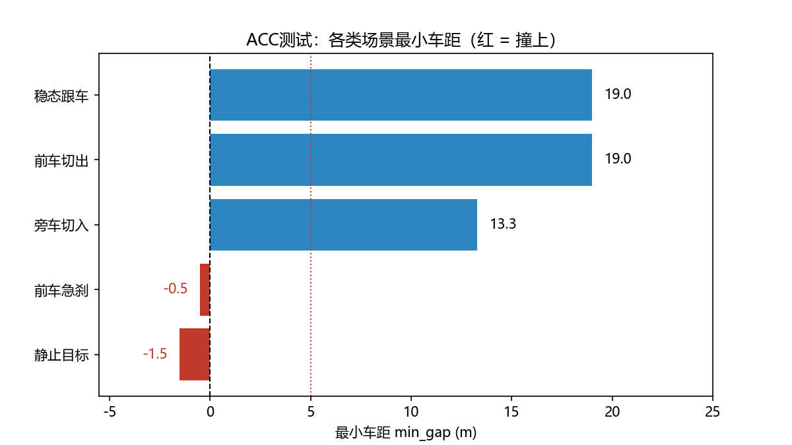

# acc_sim — ACC 被测系统与自动化评测链路

一个自包含的**简化 ACC（自适应巡航）被测系统（SUT）**，配套 pytest 单元测试、批量仿真评测平台和评测报告，
用于跑通仿真测试的完整链路：

> **被测系统 → 测试用例 → 批量执行 → 指标分析 → 结论输出**

目的是把「测试对象 + 场景用例 + 判据 + 评测报告」这条链路端到端打通，作为后续接入 CARLA 闭环仿真的基座。

---

## 这是什么

被测系统是一个**教科书式的简化 ACC**（Constant Time Gap + PID 纵向控制），刻意保持小而清晰：

- **状态机**：`OFF ↔ STANDBY ↔ ACTIVE`（ACC 的启停 / 激活 / 取消逻辑）
- **纵向控制器**：定速巡航 + 跟车（无前车巡航；有前车时按期望跟车距离做 PID 控制）
- **单元测试**：pytest 覆盖状态迁移与控制行为

> 说明：这是**教学 / 验证用的简化实现**，不是量产代码。
> 量产版的替换点（分段 PID / MPC、标定表、故障降级、多目标选择等）见文末。

## 项目结构

```
acc_sim/
├── acc/                          # 被测系统本体（SUT）
│   ├── models.py                 #   数据模型（前车信息、控制输出、参数配置）
│   ├── state_machine.py          #   ACC 状态机
│   ├── controller.py             #   PID 控制器 + 巡航 / 跟车策略
│   └── system.py                 #   组装：状态机 + 控制器 = ACCSystem
├── tests/
│   └── test_acc.py               # pytest 单元测试
├── scripts/
│   ├── simulate.py               # 单场景运动学模拟
│   ├── hard_brake_scenario.py    # 前车急刹场景
│   ├── compare_time_gap.py       # 标定量（time_gap）对比实验
│   ├── visualize.py              # 实时可视化（动态曲线 + PNG 导出）
│   ├── run_suite.py              # ★ 批量评测平台：5 场景 × 3 档 time_gap
│   └── eval_report.py            # ★ 评测器：读表 → 交叉分析 → 出图 → 结论
├── docs/                         # 评测图表
└── README.md
```

## 快速开始

```bash
pip install -r requirements.txt

# 1) 跑单元测试
python -m pytest tests/ -v

# 2) 跑单场景模拟
python scripts/simulate.py

# 3) 跑批量评测平台（生成 outputs/suite_results.csv）
python scripts/run_suite.py

# 4) 生成评测报告与图表（生成 outputs/eval_min_gap_by_scenario.png）
python scripts/eval_report.py
```

---

## 评测结果

### 评测设置

| 项 | 值 |
|---|---|
| 场景 | 5 类：稳态跟车、前车急刹、静止目标、前车切出、旁车切入 |
| 标定量 | `time_gap` ∈ {0.8, 1.5, 2.0} s |
| 用例总数 | 15（5 场景 × 3 档） |
| 判据 | **最小车距 < 5.0 m 判 FAIL** |

### 结果总览

**15 条用例：通过 9 条，失败 6 条。**



### `time_gap` 敏感度（透视表）

| 场景 | 0.8 s | 1.5 s | 2.0 s | 趋势 |
|---|---|---|---|---|
| 前车急刹 | **-0.49** | **-0.33** | **3.21** | 单调改善，但未达判据 |
| 静止目标 | **-1.52** | **-0.42** | **-0.60** | **非单调**，调参无效 |
| 旁车切入 | 13.29 | 17.12 | 17.12 | 1.5 s 后饱和 |
| 稳态跟车 | 19.00 | 33.00 | 43.00 | — |
| 前车切出 | 19.00 | 33.00 | 43.00 | — |

（数值单位：m，为各用例全程最小车距；负值表示发生碰撞）

---

## 关键发现

### 1. 缺陷分两类 —— 调参能缓解 vs 调参无效

这是本套评测最有价值的一条结论，也是缺陷定级的分水岭：

- **前车急刹**：`time_gap` 调大**单调改善**（-0.49 → 3.21 m），说明部分根因在**标定层**；
  但 2.0 档仍是 3.21 m < 5.0 m —— **调参能缓解，不能修复**。
- **静止目标**：三条用例全部碰撞，且**非单调**（-1.52 → -0.42 → **-0.60**）。
  调大参数不但没救回来，2.0 档反而更差 —— **根因不在参数层**。

> 实践含义：面对「把 `time_gap` 调大点应该就过了」这类要求，**不能一概而论**。
> 急刹场景趋势向上、或可通过（属外推，需实测验证）；静止目标场景**方向无效，调到多少都不会过**。

### 2. 边界用例："未碰撞" ≠ "通过"

用例 T006（前车急刹 / `time_gap` = 2.0）最小车距 **3.21 m** —— 没有碰撞，但未达 5.0 m 判据，仍判 FAIL。

这类"过了碰撞线、没过判据线"的用例信息量最大。需要注意：本图按「每场景取最差档」聚合，
**T006 被同场景的 -0.49 m 覆盖，未在图中单独呈现** —— 聚合口径决定了哪些数据"看得见"。

### 3. 已知评测覆盖盲区

- **前车切出场景实质为空转用例**：该场景的前车脚本在第 5 秒"切出"，但评测平台的指标记录逻辑
  在目标消失后即停止更新 `min_gap`，导致**切出之后的自车行为完全未被度量**。
  该场景因此无论被测系统实际表现如何都会 PASS。
  → 修正方向：为切出场景单独定义指标（恢复巡航的耗时、是否有误制动）。
- **旁车切入的切入时刻固定**（第 3 秒），不随 `time_gap` 变化，
  因此无法回答"跟车距离变大是否更容易被切入"。→ 需增加切入时机随参数变化的用例。

---

## 方法论说明

本项目在报告结论时遵循两条纪律：

1. **「数据结论」与「工程推断」分开写**
   —— 数据说的用"数据显示"开头、每个数字可在表中指出；推断的用"据工程经验推断"开头，并写明验证条件。
2. **引用判据必须带出处** —— 写成"按当前判据（最小车距 < 5.0 m 判 FAIL）……"，
   而不是"ACC 不合格"。判据是需求侧给的，不是评测脚本自己定的。

---

## 扩展路线

1. **接入 CARLA 闭环**：将 `ACCSystem.step(target, v_ego)` 的输入改为从 CARLA 传感器获取
   （前车距离 / 相对速度），输出油门 / 制动接到车辆控制 → 成为真正的闭环仿真被测系统。
2. **补 SUT 功能**：Follow-To-Stop（跟到停）、起步跟随。
3. **补测试手段**：边界值、随机化模糊测试、状态迁移全覆盖。
4. **补评测指标**：舒适性（加加速度 jerk）、恢复巡航耗时、误制动次数。

## 量产版替换点

| 本骨架（教科书式） | 量产版可替换为 |
|---|---|
| CTG + 单 PID | 分段 PID / 模型预测控制（MPC）/ 标定表 |
| 固定 `time_gap` = 1.5 s | 按速度分档的跟车时距表 |
| 简化的踏板映射 | 标定量（如 CANape 标定的油门 / 制动曲线） |
| 无故障处理 | 传感器失效、控制器诊断、降级策略 |
| 单前车 | 多目标（最近可跟踪目标选择） |

---

## 技术栈

Python 3.10 · pytest · pandas · matplotlib
